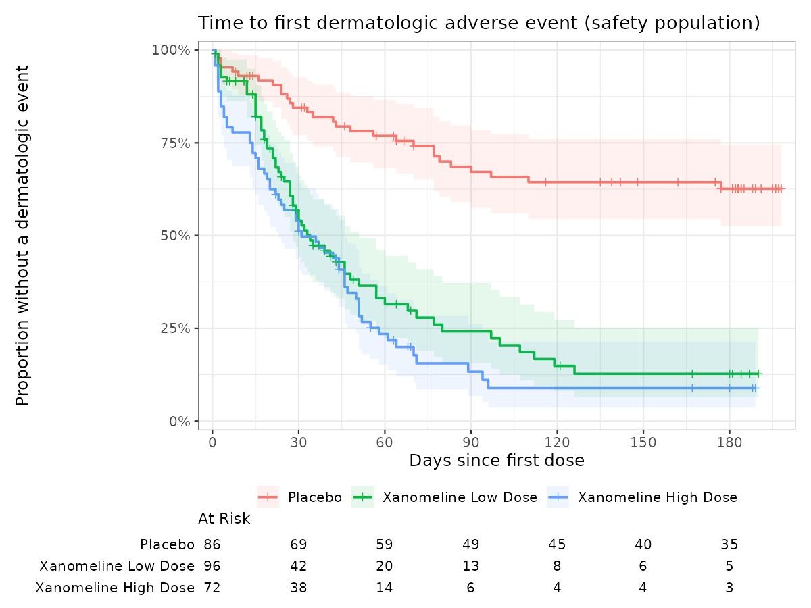

```{=html}
<style>div.cell-output pre code { font-size: 10.5px; }</style>
```

```{r setup}
suppressPackageStartupMessages({library(dplyr); library(knitr); library(rtables)})
eff <- readRDS("outputs/efficacy_results.rds")
surv <- readRDS("outputs/survival_results.rds")
qc <- read.csv("outputs/qc_adam_vs_reference.csv")
tabs <- readRDS("outputs/tables.rds")
f <- function(x, d = 2) formatC(x, format = "f", digits = d)
```

## Summary

- Derived four ADaM datasets (ADSL, ADQSADAS, ADAE, ADTTE) from raw SDTM with the
  pharmaverse `admiral` package.
- Independent QC against the CDISC reference ADaM: **`r nrow(qc)` variables,
  `r format(sum(qc$records), big.mark = ",")` values compared, `r sum(qc$matched == qc$records)` / `r nrow(qc)` variables matched 100%.**
- The primary analysis reproduces the published Table 14-3.01 of the FDA R
  Submission Pilot: dose-response p = `r f(eff$dose_response[1, 4], 3)`
  (published 0.245); high dose vs placebo p = `r f(eff$ancova_contrasts$p.value[2], 3)` (published 0.233).
- An MMRM on observed data (no LOCF) leads to the same conclusion: no
  significant cognitive benefit at Week 24.
- Dermatologic adverse events occur much earlier on xanomeline
  (Cox HR `r f(surv$cox[2, 1])` for high dose vs placebo, log-rank p < 0.001).

## Data flow

SDTM (`data-raw/*.xpt`) → `R/01_adsl.R`, `R/02_adqsadas.R`, `R/03_adae_adtte.R`
→ ADaM (`adam/*.rds`) → `R/07_qc.R` (QC) → `R/04_efficacy.R`,
`R/05_survival.R`, `R/06_tlf.R` → `outputs/`.

Derivation rules that had to be reverse-engineered to reach a 100% match:

| Rule | Detail |
|---|---|
| ADAS-Cog(11) items | The study codes 14 items; the 11-item total excludes delayed word recall, attention/visual search and maze |
| Proration | 1-3 missing items: total × 70 / (maximum score of observed items), not total × 11 / n |
| Visit windows | Day ≤1 baseline; 2-84 Week 8; 85-140 Week 16; ≥141 Week 24; closest to target day wins |
| LOCF | Applied to every ITT subject, carrying baseline forward when no post-baseline value exists |
| Treatment end | Last patch with no end date: treatment ends at end of study |
| AE start dates | Only a missing day is imputed (to the 1st); year-only dates stay missing |
| Rounding | SAS rounds half away from zero; base R rounds half to even. A `round_sas()` helper fixed 13 height/weight mismatches |

## Independent QC

```{r qc}
qc |>
  group_by(dataset) |>
  summarise(variables = n(), values = sum(records), matched = sum(matched)) |>
  mutate(match = paste0(f(100 * matched / values, 1), "%")) |>
  kable()
```

## Demographics

```{r dm, comment = ""}
#| column: page
cat(toString(tabs$dm))
```

## Primary efficacy: ADAS-Cog(11) change from baseline at Week 24

```{r eff}
anc <- eff$ancova_contrasts |>
  transmute(Comparison = contrast, Analysis = "ANCOVA, LOCF",
            `Difference (95% CI)` = paste0(f(estimate), " (", f(lower.CL), ", ", f(upper.CL), ")"),
            p = f(p.value, 3))
mm <- eff$mmrm_contrasts |>
  filter(AVISIT == "Week 24") |>
  transmute(Comparison = contrast, Analysis = "MMRM, observed",
            `Difference (95% CI)` = paste0(f(estimate), " (", f(lower.CL), ", ", f(upper.CL), ")"),
            p = f(p.value, 3))
kable(bind_rows(anc, mm))
```

ANCOVA: change ~ treatment + pooled site + baseline, Week 24 with LOCF
(the study's pre-specified primary analysis). MMRM: change ~ treatment × visit
+ baseline × visit + pooled site, unstructured covariance, Kenward-Roger
degrees of freedom, observed data only (missing at random). Negative
differences favour xanomeline. Neither analysis shows a significant effect,
and MMRM widens the confidence intervals because it does not treat carried-forward values as observed.

## Safety: time to first dermatologic event



```{r surv}
med <- as.data.frame(surv$median)
med$Arm <- sub("TRTA=", "", rownames(med))
kable(med |> transmute(Arm, Subjects = records, Events = events,
                        `Median days (95% CI)` = paste0(median, " (", `0.95LCL`, ", ", `0.95UCL`, ")")) |>
        mutate(across(everything(), ~ gsub("NA", "not reached", .x))), row.names = FALSE)
cx <- as.data.frame(surv$cox)
terms <- c("Xanomeline Low Dose vs placebo", "Xanomeline High Dose vs placebo", "Age (per year)", "Male vs female")
kable(data.frame(Term = terms, HR = f(cx[, 1]),
                 `95% CI` = paste0(f(cx[, 3]), " - ", f(cx[, 4])),
                 p = format.pval(surv$cox_p, digits = 2, eps = 0.001), check.names = FALSE), row.names = FALSE)
```

Proportional-hazards check (Schoenfeld residuals): global p =
`r f(surv$zph["GLOBAL", "p"], 2)`, so the Cox model assumption holds.

## Adverse events

```{r ae, comment = ""}
#| column: page
cat(head(strsplit(toString(tabs$ae), "\n")[[1]], 40), sep = "\n")
```

First 40 lines shown; the full table is in `outputs/t_14_5_02_teae_soc_pt.txt`.
