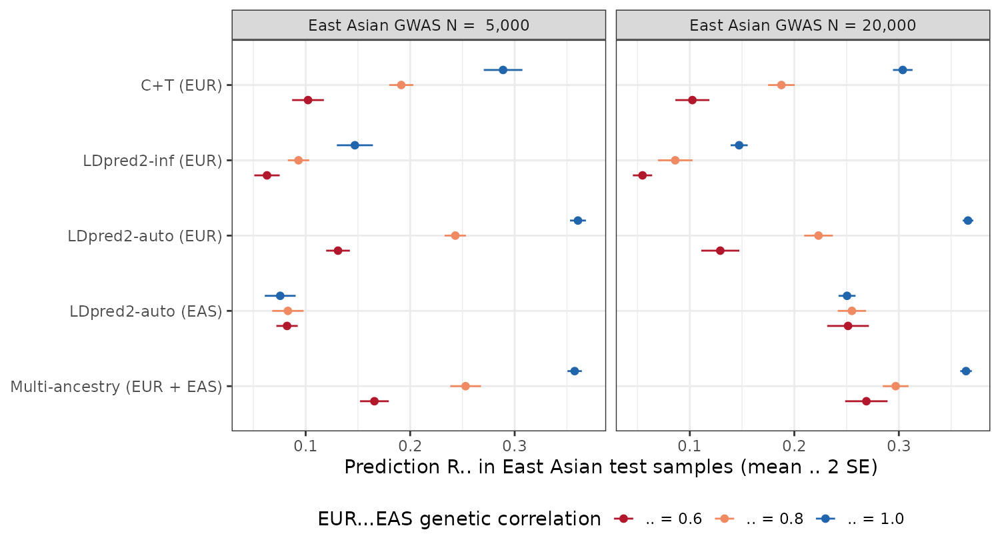

```{r setup}
suppressPackageStartupMessages({library(dplyr); library(knitr); library(tidyr)})
summ <- read.csv("outputs/summary_r2.csv")
port <- read.csv("outputs/portability.csv")
gain <- read.csv("outputs/multi_ancestry_gain.csv")
tag  <- read.csv("outputs/tagging_scenario.csv")
pt   <- read.csv("outputs/portability_untyped_causal.csv")
f <- function(x, d = 2) formatC(x, format = "f", digits = d)
pc <- function(x) paste0(round(100 * x), "%")
r2 <- function(m, tg, r, n) with(summ, r2_mean[method == m & target == tg & rho == r & n_eas == n])
```

## Summary

Most polygenic risk score (PRS) training data come from Europeans. This study
measures how much accuracy a European-trained PRS loses in East Asians, where
the loss comes from, and how much a modest East Asian GWAS recovers.

- **With identical causal effects and the causal variants genotyped, a
  European PRS transfers almost fully** (East Asian / European R² =
  `r pc(port$ratio[port$rho == 1])`).
- **Most of the real-world loss comes from two genetic sources**: differences
  in effect sizes between ancestries (genetic correlation ρ < 1) and
  differences in LD between typed SNPs and causal variants. At ρ = 0.6 the
  ratio drops to `r pc(port$ratio[port$rho == 0.6])`; hiding the causal variants
  cuts it to `r pc(pt$ratio[pt$rho == 1])` even at ρ = 1.
- **Adding an East Asian GWAS of 20,000 people raises East Asian R² by
  `r pc(gain$rel_gain_mean[gain$rho == 0.8 & gain$n_eas == 20000])` at ρ = 0.8
  and `r pc(gain$rel_gain_mean[gain$rho == 0.6 & gain$n_eas == 20000])` at ρ = 0.6**,
  compared with the European LDpred2 score alone.
- **LDpred2-auto beats clumping and thresholding (C+T) everywhere**, and it
  recovers the simulated heritability and polygenicity without any tuning data.

## Why this matters

East Asians are about a fifth of the world's population but a small share of
GWAS participants. Taiwan Precision Medicine Initiative and Biobank Japan are
closing that gap, and the practical question is the one simulated here: given
a large European GWAS and a smaller East Asian one, how should a score for East
Asian patients be built?

## Design

```{r design}
data.frame(
  Component = c("Genotypes", "SNP set", "Causal architecture", "GWAS",
                "Scores", "Evaluation", "Scenarios"),
  Choice = c(
    "1000 Genomes phase 3: 503 Europeans (EUR), 504 East Asians (EAS)",
    "199,865 SNPs with MAF ≥ 5% in both ancestries, MHC removed",
    "h² = 0.4 in EUR, 0.5% of SNPs causal, per-allele effects correlated ρ across ancestries",
    "Summary statistics simulated from LD: β̂ = Rβ + ε, ε ~ N(0, R/N); EUR N = 100,000, EAS N = 5,000 or 20,000",
    "C+T (EUR), LDpred2-inf (EUR), LDpred2-auto (EUR), LDpred2-auto (EAS), multi-ancestry combination",
    "Tune on half of EAS (simulated phenotypes), test on the other half against true genetic values",
    "ρ ∈ {0.6, 0.8, 1.0} × EAS N ∈ {5,000, 20,000} × 10 replicates; plus causal-variants-untyped runs"
  )) |> kable()
```

Simulating summary statistics from LD, instead of simulating hundreds of
thousands of individuals, is the standard approach in PRS methods papers: it
keeps the real LD structure of each ancestry while making a 100,000-person
GWAS cheap. Accuracy is reported as R² between the score and the true genetic
value, scaled to a phenotype with variance 1, so the ceiling is the heritability.

The multi-ancestry score is a weighted sum of the EUR and EAS LDpred2-auto
scores, with weights fitted on the East Asian tuning half. This is the same
idea as PRS-CSx's final step.

**Link to my thesis.** LDpred2-inf is the summary-statistic form of GBLUP, the
model behind my genomic selection work, so the same shrinkage machinery moves
from crop varieties to human disease risk. The comparison with LDpred2-auto
shows the cost of GBLUP's "every SNP has a small effect" assumption when the
trait is sparse.

## Results



```{r table}
summ |>
  filter(target == "EAS") |>
  mutate(cell = paste0(f(r2_mean, 3), " (", f(r2_se, 3), ")"),
         scen = paste0("ρ=", rho, ", N_EAS=", format(n_eas, big.mark = ","))) |>
  select(Method = method, scen, cell) |>
  pivot_wider(names_from = scen, values_from = cell) |>
  arrange(match(Method, c("C+T (EUR)", "LDpred2-inf (EUR)", "LDpred2-auto (EUR)",
                          "LDpred2-auto (EAS)", "Multi-ancestry (EUR + EAS)"))) |>
  kable(caption = "East Asian prediction R², mean (SE) over 10 replicates")
```

### Where the European score loses accuracy

```{r port}
bind_rows(
  port |> transmute(`Causal variants` = "Genotyped", rho, Ratio = paste0(f(ratio), " (", f(ratio_se), ")")),
  pt |> transmute(`Causal variants` = "Not genotyped", rho, Ratio = paste0(f(ratio), " (", f(ratio_se), ")"))
) |>
  rename(`Genetic correlation ρ` = rho, `EAS R² / EUR R², LDpred2-auto (EUR)` = Ratio) |>
  kable()
```

Effect-size heterogeneity behaves as theory predicts: with genotyped causal
variants the ratio tracks ρ² (0.36 and 0.64 for ρ = 0.6 and 0.8). When the
causal variants are not on the SNP set, the score depends on tagging SNPs whose
LD with the causal variant differs between Europeans and East Asians, and
accuracy drops even with identical biology.

### What an East Asian GWAS adds

```{r gain}
gain |>
  transmute(`ρ` = rho, `EAS GWAS N` = format(n_eas, big.mark = ","),
            `Relative R² gain over EUR LDpred2-auto` = paste0(pc(rel_gain_mean), " (SE ", pc(rel_gain_se), ")")) |>
  kable()
```

With ρ = 1 the East Asian data add nothing: the European GWAS already
estimates the same effects more precisely. The smaller ρ, the more an
ancestry-matched GWAS is worth, even at a fifth of the European sample size.

## Limitations

- 1000 Genomes has about 500 people per ancestry, so LD is estimated with
  noise. The same samples provide LD and test genotypes; phenotypes in the test
  half are never used for training.
- LD is block-diagonal over 2 Mb blocks for both simulation and fitting; real
  data add reference-panel mismatch.
- The SNP set is 200,000 common SNPs, not the ~1 million HapMap3 variants
  used in practice.

## Reproduce

```bash
bash R/00_prepare_genotypes.sh     # needs data-raw/chr*.bed from data-raw/get_chr.sh
Rscript R/01_ld.R                  # EUR and EAS LD references
bash R/run_simulations.sh          # 80 replicates
Rscript R/03_summarise.R
quarto render report.qmd
```
