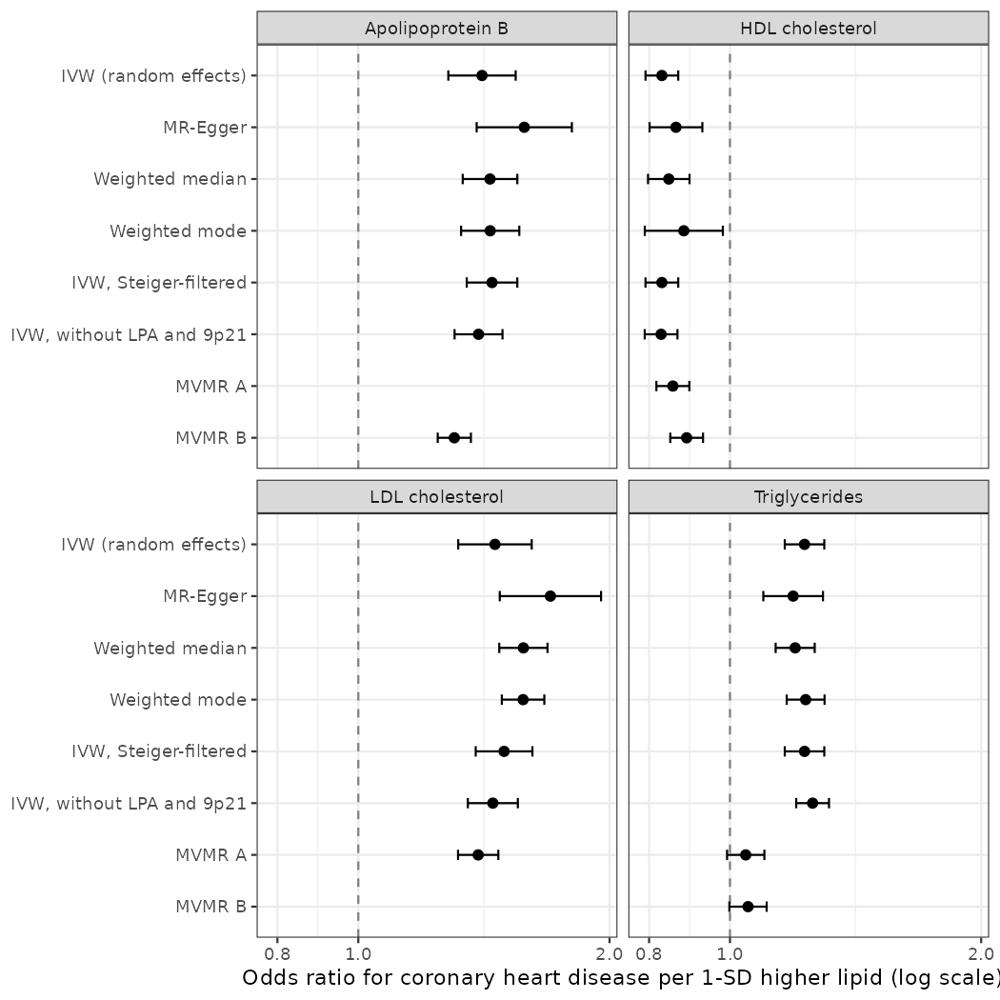
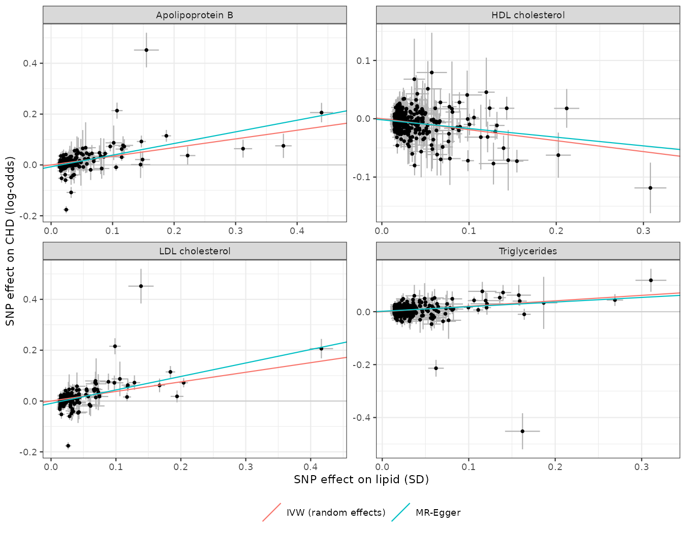

```{r setup}
suppressPackageStartupMessages({library(data.table); library(dplyr); library(knitr)})
uv <- fread("outputs/mr_univariable.csv")
mv <- fread("outputs/mr_multivariable.csv")
port <- fread("outputs/instrument_portability_eas.csv")
harm <- fread("data/harmonised.tsv")
f <- function(x, d = 2) formatC(x, format = "f", digits = d)
ci <- function(o, l, u) paste0(f(o), " (", f(l), " to ", f(u), ")")
get <- function(d, e, m) d[exposure == e & method == m]
```

## Summary

Genetic variants that raise a lipid trait act like a lifelong randomized
"treatment". Comparing their effects on the lipid with their effects on
coronary heart disease (CHD) estimates the causal effect of the lipid itself.

- **LDL cholesterol and apolipoprotein B are causal for CHD.** Per 1-SD
  higher LDL-C, CHD odds rise by `r round(100 * (get(uv, "ldl", "IVW (random effects)")$OR - 1))`%
  (IVW OR `r with(get(uv, "ldl", "IVW (random effects)"), ci(OR, OR_lower, OR_upper))`).
  All five robust methods agree.
- **Triglycerides look causal on their own, but not once ApoB is accounted
  for.** In the multivariable model with ApoB and HDL-C, the TG odds ratio
  falls from `r f(get(uv, "tg", "IVW (random effects)")$OR)` to
  `r with(mv[model == "B: ApoB + HDL + TG" & exposure_label == "Triglycerides" & method == "Multivariable IVW"], ci(OR, OR_lower, OR_upper))`,
  consistent with TG-rich lipoproteins acting mostly through the number of
  ApoB-containing particles (the MR-Egger version leaves a small residual
  effect, OR `r with(mv[model == "B: ApoB + HDL + TG" & exposure_label == "Triglycerides" & method == "Multivariable MR-Egger"], f(OR))`).
- **HDL cholesterol keeps an inverse association** (multivariable OR
  `r with(mv[model == "B: ApoB + HDL + TG" & exposure_label == "HDL cholesterol" & method == "Multivariable IVW"], ci(OR, OR_lower, OR_upper))`).
  HDL-raising drugs (CETP inhibitors, niacin) failed in trials, so this is
  more likely residual pleiotropy than a target (see Limitations).

## Data and design

| | Exposure | Outcome |
|---|---|---|
| Source | Pan-UK Biobank, European ancestry | FinnGen release 12, endpoint I9_CHD |
| Traits | LDL-C, HDL-C, triglycerides, ApoB (inverse-rank-normalised, per SD) | Coronary heart disease (log-odds) |
| Sample size | ~400,000 per lipid | ~500,000 (Finnish) |
| Build | GRCh37 | GRCh38, matched by rsID |

The two samples do not overlap, which avoids the bias toward the observational
association that sample overlap causes in two-sample MR.

**Instruments.** SNPs with p < 5×10⁻⁸ for the lipid, LD-clumped at r² < 0.001
within 10 Mb using 1000 Genomes European genotypes (prepared in project 02),
mapped to rsIDs from the 1000 Genomes VCFs, then harmonised to the same effect
allele. Palindromic SNPs were kept only when allele frequency resolved the strand.

```{r instruments}
harm[, .(Instruments = .N, `Mean F-statistic` = round(mean((beta_x / se_x)^2))), by = exposure] |>
  mutate(exposure = c(ldl = "LDL-C", hdl = "HDL-C", tg = "Triglycerides", apob = "ApoB")[exposure]) |>
  rename(Exposure = exposure) |> kable()
```

All F-statistics are far above 10, so weak-instrument bias is negligible.

## Univariable MR



```{r uv}
uv |>
  transmute(Exposure = exposure_label, Method = method, SNPs = n_snps,
            `OR per SD (95% CI)` = ci(OR, OR_lower, OR_upper),
            p = format.pval(p, digits = 2)) |>
  kable()
```

How the methods guard against invalid instruments:

| Method | Assumption it relaxes |
|---|---|
| MR-Egger | Pleiotropy allowed if independent of instrument strength (InSIDE); intercept tests directional pleiotropy |
| Weighted median | Consistent if ≥50% of the weight comes from valid instruments |
| Weighted mode | Consistent if the largest group of instruments with similar estimates is valid |
| Steiger filtering | Drops SNPs that explain more variance in CHD than in the lipid (reverse direction) |
| Without LPA and 9p21 | Removes two known non-lipid CHD loci: Lp(a) and CDKN2B-AS1 |



Each point is one SNP. The LPA variants (top of the LDL and ApoB panels) and
the 9p21 variant (bottom) are the clearest outliers; removing them barely moves
the estimates.

Cochran's Q is large for every exposure (p < 1e-90), so there is substantial
heterogeneity, and the MR-Egger intercept is non-zero for LDL-C
(p = `r f(get(uv, "ldl", "MR-Egger")$egger_intercept_p, 3)`). That is why the
random-effects IVW and the robust methods, not fixed-effect IVW, carry the
conclusions.

## Multivariable MR

Lipid traits share many variants, so univariable estimates can borrow each
other's effects. Multivariable MR estimates each trait's direct effect.

```{r mv}
mv |>
  transmute(Model = model, Exposure = exposure_label, Method = method, SNPs = n_snps,
            `OR per SD (95% CI)` = ci(OR, OR_lower, OR_upper),
            p = format.pval(p, digits = 2)) |>
  kable()
```

## Do the European instruments carry over to East Asians?

The same instruments' lipid effects in the Pan-UKB East Asian sample
(about 2,500 people) were regressed on their European effects.

```{r port}
port |>
  transmute(Exposure = c(ldl = "LDL-C", hdl = "HDL-C", tg = "Triglycerides", apob = "ApoB")[exposure],
            SNPs = n, `Same direction` = paste0(round(100 * sign_concordance), "%"),
            `EAS effect / EUR effect (slope)` = f(slope_eas_on_eur)) |>
  kable()
```

Most instruments point the same way, but East Asian effects are about half the
European size. Part of that is winner's curse in the European discovery GWAS
and noise in the small East Asian sample. An East Asian MR therefore needs East
Asian instruments, for example from Biobank Japan or Taiwan Biobank.

## Limitations

- Pleiotropy is substantial (large Q). The robust methods agree, but none of
  them can rule it out completely, and the HDL-C result illustrates this.
- Exposure effects are per SD of inverse-rank-normalised traits, not mg/dL.
- FinnGen is a founder population; allele frequencies differ slightly from
  UK Biobank (harmonisation checks this).
- Effect sizes are lifelong genetic differences and are larger than the
  effect of lowering lipids for a few years with a drug.

## Reproduce

```bash
bash R/00_download_sumstats.sh    # stream and slim the public GWAS files
Rscript R/01_instruments.R        # select, clump and annotate instruments
Rscript R/02_outcome_harmonise.R  # look up in FinnGen and align alleles
Rscript R/03_mr.R                 # MR, MVMR, figures
quarto render report.qmd
```
